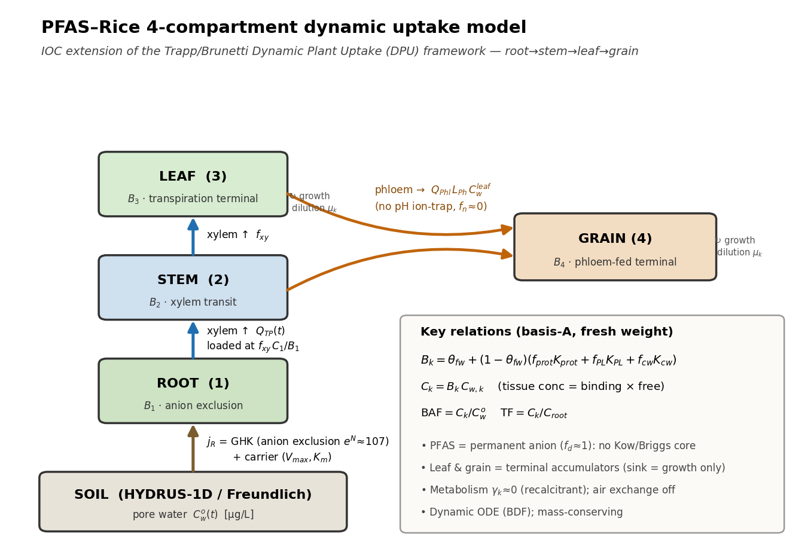

# PFAS–벼 흡수 모델 종합 문서 (기능·검증·데이터·실험·표기)

> 이 레포 전체를 한눈에 보는 문서입니다. **무엇을 하는가**, **얼마나 믿을 수 있는가**, **무엇이 부족한가**,
> **그래서 어떤 실험이 필요한가**, 그리고 **기호 정리**를 담았습니다. 수치는 2026-10-26 개정 1(출처 있는 값만 사용) 모델 기준이고,
> 각 수치를 낸 스크립트와 자세한 내용은 `CLAUDE.md` §6, 모든 입력의 출처·민감도는 `docs/ASSUMPTIONS.md`에 있습니다.
> 깊은 유도는 `docs/pfas_rice_compartmental_model.tex`입니다.
>
> 🖥️ **앱 사용법**(일반인~전문가, 한국어)은 **[`docs/MANUAL_KR.md`](MANUAL_KR.md)** 를 보세요.



---

## 1. 한 줄 요약

벼(*Oryza sativa*)에서 **영구 음이온성 PFAS**의 생물축적을 푸는 **4구획 동역학 흡수 모델**입니다.
Trapp/Brunetti의 **Dynamic Plant Uptake(DPU)** 틀을 **이온성 유기화합물(IOC)** 로 확장했고, 토양 쪽은
**HYDRUS-1D**와 단방향 결합합니다. **결합은 독립 측정값으로 받치고, 이행(transport)은 한 현장(Yamazaki 2023,
쓰쿠바 2020)에 보정**했습니다. 모든 입력은 문헌값, 데이터가 식별하는 적합값, 제거된 기작, 또는 출처 있는
범위(중앙값으로 계산하고 영향을 밴드로 보고) 중 하나입니다. 기본 구성은 개정 2a 뒤 사전 등록 규칙으로 정한
**재분배 지상부 + congener별 물관 적재계수 `f_xy`**(`redistributed_fit`)이고, 보정에 쓰지 않은 세 데이터셋에서
log10 0.44–1.33 빗나갑니다(4구획 자유 음이온은 1.49–2.04). *예측 검증이 끝난 모델은 아닙니다*: `f_xy`·`L_Ph`·`r_eq`는
Yamazaki에 물질마다 맞춘 값이라 그 현장에서는 재현이고, 생육단계별 낟알(Li 2025)은 낮게 계산합니다.

---

## 2. 모델이 하는 일

### 2.1 과학적 핵심
- **PFAS = 영구 해리 음이온**(`pKa` 매우 낮음 → `f_d ≈ 1`). 중성화합물의 **Kow/Briggs 분배 코어는 적용되지 않습니다.**
- **뿌리 흡수 `j_R`**: 이론(`docs/`)은 음이온을 밀어내는 전기확산(GHK) + 포화 운반체의 하이브리드를 유도하지만, 논 뿌리
  막전위와 PFAS 운반체 상수(Km, Vmax)의 출처가 없고 찾은 용량 시리즈가 모두 선형이라, 모델은 **선형 평형 유입**
  `λ_eq·(r_eq·C_w^o − C_w,root)`를 씁니다(`r_eq`는 뿌리에 맞춤, `λ_eq`는 수치적으로 수렴한 값).
- **물관(xylem)** 은 뿌리의 자유 음이온을 적재계수 `f_xy`로 싣습니다. 기본 구성에서 `f_xy`는 congener마다 Yamazaki의
  짚에 맞춘 값입니다. 선택 사항인 지질 결합 경로(`lipid_loading=True`, 개정 1의 기본)는 막 지질에 결합한 몫도
  `g_xy · C_root`로 싣고, 모든 사슬 공통 상수 `f_xy`·`g_xy` 두 개를 씁니다.
- **지상부(기본: 재분배 지상부)**: 증산류가 줄기 4구간, 잎, 낟알을 지나고, 기관마다 자기 증산이 가져온 물질의 일부를
  모두 붙잡습니다(보유율 1, 유도값). 엽초+줄기 몫 0.29(0.22–0.36)는 4구간에 고르게, 이삭 몫은 출수 전 0, DVS 1에서
  0.21(0.09–0.33), DVS 2에서 0.07(0–0.14)이며 그 사이는 선형입니다(모두 문헌 범위의 중앙값). `shoot="4pool"`은
  짚 하나짜리 구조로, 같은 이삭 몫으로 잎/이삭을 나눕니다.
- **낟알 = 현미**(개정 2a): 현미는 체관으로만 채워지고(Zee 1972; Oparka & Gates 1981), 이삭의 증산이 실어 온 물질은
  왕겨·이삭축 풀에 남습니다(`husk`, 벼 기준 `rough`도 보고). 왕겨 비율은 Ansari 2017 경과를 성숙기 앵커 0.2075(0.161–0.254)에
  맞춰 쓰고, 이삭축은 출수 무렵 이삭의 0.5(0–1)입니다(`src/panicle.py`).
- **체관(phloem)은 잎에서 두 갈래**입니다. 낟알로는 낟알 건물 생장에 드는 수액만큼(`T_C,Ph`), 뿌리로는
  증산량의 비율 `φ`만큼 갑니다. 농도는 둘 다 `L_Ph · C_leaf/B_leaf`.
- **잎·낟알은 종착 축적기**: 배출이 성장 희석뿐이고 성숙기에 `μ→0`이라 정상상태가 없습니다.
  최종 농도 = 시간적분/최종질량이므로 **동역학 모델이 필수**입니다.
- 낟알은 체관급이라 약산 pH 이온트랩이 **적용되지 않습니다**(`f_n ≈ 0`). 적재는 운반체/채널(`L_Ph`).
- 대사 `γ_k ≈ 0`(난분해), 공기 교환 off(`K_AW ≈ 0`).

### 2.2 핵심 관계식 (basis-A, 생체중 기준)
```
B_k = θ_fw + (1−θ_fw)·(f_prot·K_prot + f_PL·K_PL + f_cw·K_cw)     [L/kg fw]
C_k = B_k · C_w,k          BAF = C_k / C_w^o          TF = C_k / C_root
```
`(1−θ_fw)`는 **건물→생체중 변환**입니다(빼면 `B_k`를 약 3배 과대평가). 풀이는 BDF stiff ODE이고 질량이 정확히 보존됩니다.

### 2.3 무엇과 비교하나
- **기관 질량 `M_k`는 생체중**입니다. 작물 모델(ORYZA2000 등)은 건물을 내므로 `B_k`와 같은 `θ_fw`로 변환합니다(`src/organ_mass.py`).
  뿌리·줄기·잎의 `θ_fw`는 생육 단계(DVS)에 따라 문헌 앵커 사이를 선형으로 따라가고(개정 2a; 뿌리 0.8245 → 0.6365),
  생체중·결합계수·수확 관측 연산자가 같은 θ(t)를 읽습니다.
- **관측과 같은 건물중 기준**으로 비교합니다. 수확 시 죽은 잎은 작물 모델의 잎 고사로부터 재구성해 잎·짚에 포함합니다(`src/harvest.py`).
- **기본 구동 조건은 보정 현장의 재배 연도**입니다(`src/site_scenario.py`): JMA 쓰쿠바 2020 기상, Yamazaki 이앙일에 맞추고
  출수·수확일로 생육 단계를 보정한 ORYZA2000 잠재생산 이식(IR72.D92), FAO-56 항으로 계산한 ORYZA 증산.
  `scenario="generic"`은 기후값과 고른 생장 드라이버를 씁니다.

### 2.4 무엇을 입력하면 무엇이 나오나
| 입력(화합물) | 입력(시나리오/작물/토양) | 출력 |
|---|---|---|
| congener 이름, SMILES, 또는 중성물질 log Kow → `K_PL/K_prot/K_cw, f_d, f_xy` | 공극수 `C_w^o(t)`, 증산 `Q_TP(t)`, 생장 `M_k(t)`, `E_m` | 조직별 농도 `C_k(t)`, **BAF/TF**(건물중), 경로별 기여 분해 |

결합·해리는 구조에서 예측되지만 **`f_xy`(이행)는 구조에서 나오지 않습니다**(`docs/structure_input.md`).

### 2.5 모듈 맵
| 파일 | 역할 |
|---|---|
| `src/pfas_rice_plant_module_4pool_surf.py` | **정본** 4구획 ODE 코어(+표면 pool), 체관 두 갈래 `phloem_flows` |
| `src/pfas_rice_plant_module_nstem_leaf.py` | 재분배 지상부: N분절 줄기 + 잎, 기관별 증산 침착·보유 |
| `src/site_scenario.py` · `src/oryza2000.py` · `src/fao56.py` | 보정 현장 연도 구동자(기상·작물·증산) |
| `src/organ_mass.py` · `src/harvest.py` | 건물→생체중 변환 · 수확 관측 연산자(고사엽, 건물중) |
| `src/soil_hydrus.py` | **실제 HYDRUS-1D** 엔진(phydrus) → `C_w^o(t), Q_TP(t)` (Method A) |
| `src/literature_params.py` | 문헌 QSPR/anchor(인용): `Koc, K_PL, K_prot, f_d`, Kim 2019 표 |
| `src/pfas_structure.py` | **SMILES → Compound** (RDKit; read-across + QSPR) |
| `src/neutral_dpu.py` | 중성 유기물 경로(같은 ODE, z=0, Briggs `K_PW`·TSCF) |
| `src/model_api.py` | UI 무관 API: `simulate()`, `yamazaki_harvest_baf()`, `simulate_nstem_leaf()`, `simulate_neutral()`, 역추정 |
| `app.py` + `ui/` + `src/plots.py` | Streamlit 앱(일반 모드 한국어, 전문가 모드 영어) |

---

## 3. 검증 — 보정과 검증을 구분해서

### 3.1 보정 현장(Yamazaki 2023) — 재현이지 검증이 아님
변형마다 congener별 `r_eq`(뿌리, 닫힌 해)와 `L_Ph`(낟알)를 맞추고, `*_fit` 변형은 congener별 `f_xy`(짚)를, 지질 변형은
모든 사슬 공통 상수 두 개(`f_xy = a` 0.0672, `g_xy` 0.00786; 후진 제거로 `b`, `g_ph`, `pfsa_ln`, K_PL 게이트는 빠짐)를 더합니다
(`validation/refit_sourced.py`, 기록 `validation/refit_sourced.json`, 결과 판정 `docs/PREREG_sourced_values.md` §8).

| 변형 | 전체 | 뿌리 | 짚 | 낟알 |
|---|---|---|---|---|
| **재분배 + congener별 `f_xy`(기본; 포화 재현)** | **0.116** | 0.000 | 0.156 | 0.128 |
| 재분배 + 지질(개정 1의 기본) | 0.156 | 0.000 | 0.266 | 0.000 |
| 4구획 + 지질 | 0.152 | 0.000 | 0.259 | 0.000 |
| 재분배 자유 음이온 | 1.261 | 0.000 | 1.638 | 1.463 |
| 4구획 자유 음이온 | 1.308 | 0.000 | 1.791 | 1.396 |

기본 구성은 PFDoDA를 빼고 모든 칸을 재현합니다(PFDoDA는 `f_xy`가 1에 닿아 짚 −0.52, 낟알 −0.40 log). 이삭의 증산 몫이
왕겨로 가면서 낟알 칸이 있는 모든 congener가 모든 변형에서 `L_Ph > 0`을 얻습니다. 자유 음이온(사전 `f_xy`)은 PFOA 이상의
낟알에 어떤 `L_Ph`로도 닿지 못합니다.

### 3.2 독립 데이터로 옮기기 (보정에 쓰지 않은 데이터; `validation/transfer_sourced.py`)
| 데이터 | 4구획 자유 음이온 | 재분배 자유 음이온 | 4구획 + 지질 | 재분배 + 지질 | **기본** |
|---|---|---|---|---|---|
| Tang 2026 부위별 TF, 0.1 µg/g | 1.87 | 1.74 | 0.92 | 0.68 | **0.69** |
| Kim 2019 현미 BAF, PFOA 제외, 점 / [0, MDL] 구간 | 2.04 / 1.78 | 2.12 / 1.87 | 0.56 / 0.45 | 0.56 / 0.44 | **0.56 / 0.44** |
| Li 2025 생육단계별 TF, 지상부 / 낟알(현미) | 1.49 / 1.82 | 1.28 / 1.86 | 0.94 / 1.38 | 0.38 / 1.36 | **0.47 / 1.33** |

- **기본 구성 전환**(사전 등록 5.3, §8; 사용자가 적용): `redistributed_fit`이 기존 기본(재분배 + 지질)보다 Li 낟알에서 낫고
  (−0.029, 95% [−0.046, −0.006]) 나머지 종말점에서는 모두 동률입니다. 차이가 작고, 새 기본은 Yamazaki 짚을 재현하는 변형입니다.
- **Li 낟알**: 현미는 물관을 받지 않으므로 개정 1(1.019)보다 낮게 계산합니다. 벼(현미+왕겨) 기준으로 읽으면 기존 기본 0.850입니다.
- **불확실성 범위**: 기본 구성의 전이 오차(`params/transfer_scores.json`) 중앙값 log10 0.562(**×3.65**)를 앱 일반 모드의 범위로
  씁니다. **주의**: 이 세 자료는 기본 구성을 고르는 데 쓰였으므로 이 범위는 낙관적일 수 있습니다.
- **출처 있는 입력 범위**(`params/input_range_band.json`): 적합값을 고정하고 각 범위를 양 끝으로 옮기면 낟알 ÷2.98 / ×3.63,
  짚 ÷1.40 / ×1.90, 뿌리 ÷1.29 / ×1.29(11종 중앙값). 자포니카 품종 파라미터 세트가 짚(11/11)과 낟알(7/11)을 가장 크게
  좌우합니다. 모든 입력을 동시에 끝으로 옮기면 66칸 중 38칸만 이 밴드 안에 듭니다(입력 간 상호작용).
- **역추정**: Kim PFOA 현미 0.349 µg/kg에서 공극수를 0.648 µg/L로 추정(측정 0.0787의 8.2배; 95% 0.051–8.18로 측정값을
  포함).
- **Kim 2019 PFOA**: 사이트별 중도절단 기하평균 9.94 L/kg(90% 4.57–20.2). 기본 구성 0.539 L/kg은 구간보다 낮습니다(−1.27 log).
- 전이 데이터셋은 각 현장의 기상·일정이 레포에 없어 모두 쓰쿠바 2020 조건으로 계산했습니다.

### 3.3 메커니즘 점검
- **뿌리 유입**: 선형 평형(개정 1). 운반체 상수(Km, Vmax)·논 뿌리 막전위의 출처가 없고, 찾은 용량 시리즈가 모두 선형입니다.
  이전의 운반체 vs 우회로·용량 시리즈 분석은 `validation/archive/`에 기록으로 남아 있습니다.
- **식별성**(`bayesian_inverse_demo.py`, 건중 조직 농도 사용): 수송을 고정하면 `Q_TP` 규모와 `Cwo`는 복원됩니다(corr −0.78,
  cond 27). `Q_TP`와 `f_xy`는 곱만 정해지고(corr −0.95, cond 87), `Cwo`와 `r_eq`는 정확한 능선입니다(cond 1.3e16) →
  공극수·물관 수액 독립 측정이 필요.
- **HYDRUS-1D**: 약흡착 단쇄는 담수기에 용탈되고 장쇄는 완충됩니다. 논 토양 입력값(f_oc, 용적밀도, 침투, 배수 일정, 관개수
  오염원)이 아직 현장 출처를 갖추지 않아 토양 시나리오 수치는 싣지 않습니다(개정 2).

### 3.4 결과를 움직이는 입력 (`docs/ASSUMPTIONS.md`, `params/value_provenance.csv`)
출처 없는 선택값은 없습니다. 출처 있는 범위 중에서는 자포니카 품종 파라미터 세트(짚·낟알), `φ`(낟알), 뿌리 조성
`f_cw`·`f_PL`(뿌리)이 가장 크게 움직입니다(3.2의 밴드).

### 3.5 중성 유기물(맞춘 것 없음; `params/neutral_scores.json`)
지질은 건중 기준으로 두고 기관 수분에서 생체중으로 환산하며, 표마다 그 식물의 출처 있는 수분·지질을 씁니다(부록 5.10).
Liu 2023 벼 뿌리 분배 0.212(평형 0.204; 건중으로 읽으면 0.821) · Ge 2017 잎 TF 0.631(줄기 행은 영양생장기 벼 줄기 수분
출처가 없어 제외) · Kodešová 2019 0.157(평형 0.172) · Li 2019 수경 0.677 · Li 2019 토양 0.418 · Briggs 1983 보리 줄기 0.357.
휘발성 화합물은 데이터로 시험하지 않았습니다. 자세히는 `docs/neutral_dpu_validation.md`.

### 3.6 정직한 결론
- 구조(음이온 배제, 질량 보존, 종착 축적)는 검증됐고, 단쇄의 짚 > 뿌리 방향도 현장과 같습니다.
- 절대 수치는 대략치입니다(기본 구성 ×3.65, 독립 데이터 전이 오차의 중앙값). **낟알이 가장 불확실**합니다. 수확 시점
  Yamazaki 낟알은 맞추지만 생육단계별 낟알(Li)과 Kim PFOA는 낮고, 왕겨/현미 비는 Choi 2018보다 작습니다(PFOS 약 1 log).
  낟알 적재 시기와 경로는 수확기 자료만으로는 정할 수 없습니다. 장쇄의 높은 `f_xy`는 짚에 맞춘 값이라 기작이 확정되지 않았습니다.

---

## 4. 부족한 데이터 (공백)

| # | 공백 | 영향 | 비고 |
|---|---|---|---|
| 1 | **Yamazaki 2023 SI 원자료** (S16 수질, S18/S19 조직, MQL 표시, 재식밀도, 육묘) | 보정의 관측값 자체 | 현재 그림·표에서 재구성 |
| 2 | **운반체 동역학** (`Vmax/Km`, 억제제 실험) | 선형 유입이 운반체·채널을 묶음 → 분리 불가 | 찾은 용량 시리즈는 모두 선형 |
| 3 | **조직·시간 분해 BAF/TF + 짝지은 공극수**, 특히 장쇄 낟알 | 장쇄 낟알 메커니즘 판별 | 온실 시계열 |
| 4 | **생육단계별 벼 이삭 증산 몫** | 이삭(왕겨·이삭축) 유입; 개정 2a 뒤 현미에는 닿지 않음 | 문헌 범위(넓음) |
| 4b | **현장 품종의 작물 파라미터** (자포니카) | 짚·낟알 밴드의 최대 요인 | 문헌 세트 5종을 범위 끝으로 |
| 5 | **φ**(체관 → 뿌리 비율) | 짚 밴드의 주요 요인 | 문헌 범위 0.02–0.10 |
| 5b | **벼 체관 수액량 / 낟알 건물** (`T_C,Ph`) | 낟알 체관 유입 | 문헌 범위 4.4–7.8 L/kg |
| 6 | **생육기 기관 수분 함량** (`θ_fw`) | 건물↔생체중 모든 단계 | 개정 2a: 문헌 단계 앵커 사이 선형; 현장 측정 없음 |
| 7 | **벼 뿌리 세포벽·plaque PFAS 흡착** (`K_cw`, `K_surf`) | 결합·격리 항 | `K_cw`는 다당류·리그닌 값에서 유도, plaque는 꺼짐 |
| 8 | **혐기/담수 흡착 등온선** | 담수기 `C_w^o` | 모두 호기 자료 |
| 9 | **전이 데이터셋의 현장 기상·재배 일정** (Tang, Kim, Li) | 전이 시험의 구동자 | 지금은 쓰쿠바 2020으로 대체 |
| 10 | **에테르/설폰아마이드 Koc·K_PL**, GenX 등 대체물질 벼 자료 | 구조 입력 신규 물질 | 단일 anchor |

---

## 5. 따라서 해야 하는 실험

| 우선 | 실험 | 해소하는 공백 | 모델에 들어가는 것 |
|---|---|---|---|
| **HIGH** | **억제제 ± 농도열 뿌리흡수 assay** | 2 | `Vmax/Km`, 운반체 vs 채널 |
| **HIGH** | **온실 논 시계열**(2품종, 시기별 뿌리/짚/왕겨/현미/백미 + 짝지은 공극수, 재배 일정 기록) | 3, 6, 9 | 진짜 표본외 검증, 장쇄 낟알 |
| **HIGH** | **혐기 배치 흡착**(제어 Eh) | 8 | 담수기 `C_w^o` (HYDRUS 입력) |
| MED | **물관 삼출액 `f_xy` + 이삭자루 체관 `L_Ph`·수액량 + 이삭 증산 몫** | 4, 5, 5b | 이행 파라미터·`lam_grain` 직접 측정 |
| MED | **뿌리 세포벽 분획·plaque 배치 흡착 + 탈착** (사슬길이 × 머리기) | 7 | `K_cw`, 격리 항 |
| MED | **현장 미세전극 `E_m`** | — | 이론의 GHK 배제항 검증(지금 모델에는 없음) |

---

## 6. 기호 정리

> 단위: 시간 **day**, 수용액 농도 **µg/L**, 조직 농도 **µg/kg**(모델 내부 생체중, 보고는 건물중), 질량 **kg**, 유량 **L/day**.
> 기호는 `docs/pfas_rice_compartmental_model.tex`와 1:1 대응합니다.

### 6.1 상태·구획
| 기호 | 의미 | 단위 |
|---|---|---|
| `k = 1,2,3,4` | 구획: root, stem, leaf, grain(fruit) | – |
| `C_k(t)` | 구획 k 조직 농도 | µg/kg fw |
| `C_w,k` | 구획 k 자유(수상) 농도 = `C_k/B_k` | µg/L |

### 6.2 Tier-0 — 입력/기지값
| 기호 | 의미 | 단위 | 출처 |
|---|---|---|---|
| `C_w^o(t)` | 토양 공극수 자유 농도(노출) | µg/L | 상수(기본) · HYDRUS · Freundlich |
| `Q_TP(t)` | 증산 = 뿌리 물흡수 | L/day | ORYZA2000 Tp(현장 연도) / `forcing_rice`(generic) |
| `Q_g = (dM_4^dry/dt)·T_C,Ph` | 낟알로 가는 체관 유량 | L/day | 낟알 건물 생장 × 수액량 |
| `Q_r = φ·Q_TP` | 뿌리로 되돌아가는 체관 유량 | L/day | – |
| `M_k(t)` | 구획 생체중 질량 | kg | ORYZA2000 이식 → `organ_mass` |
| `μ_k = (dM_k/dt)/M_k` | 성장 희석률 | 1/day | – |
| `f_d` / `f_n` | 해리(음이온) / 중성 분율 | – | `f_d≈1, f_n≈0` (Goss 2008) |
| `γ_k` | 대사율 | 1/day | `≈0` |
| `θ_fw` | 생체중 수분 분율 | – | `params/rice_composition_sourced.csv` |
| `f_prot, f_PL, f_cw` | 단백질/인지질/세포벽 **건물** 질량분율 | – | `params/rice_composition_sourced.csv` |
| `T_C,Ph` | 낟알 건물 생장당 체관 수액량 | L/kg dry | 문헌 범위 6.1 (4.4–7.8) |
| `φ` | 체관 → 뿌리 비율(증산 대비) | – | 문헌 범위 0.06 (0.02–0.10) |
| 엽초+줄기, 이삭 증산 몫 | 재분배 지상부의 기관별 증산 몫 | – | 문헌 범위(2.1 참고) |

### 6.3 Tier-1 — BAF로 식별(보정 대상)
| 기호 | 의미 | 단위 | 비고 |
|---|---|---|---|
| `B_k` | 결합인자 (`C_k=B_k·C_w,k`) | L/kg fw | basis-A |
| `f_xy` | 뿌리→물관 적재계수(TSCF 유사), ∈(0,1] | – | 기본: congener별 Yamazaki 짚 적합; 지질 변형은 공통 상수, 자유 음이온 변형은 단조 물리값 |
| `g_xy` | 지질 결합 몫의 물관 적재 | – | 지질 변형만; 모든 사슬 공통 상수(Yamazaki 적합; `g_ph`는 후진 제거) |
| `L_Ph` | 체관 적재계수 (≥ 0, 상한 없음) | – | congener별 적합(낟알) |
| `r_eq` | 뿌리 평형비(뿌리 수분 / 공극수) | – | congener별 적합(뿌리, 닫힌 해) |
| `λ_eq` | 평형 속도(수치값, 1e6에서 수렴) | 1/day | 수치 |

### 6.4 Tier-2 — 운반체 동역학(억제제 자료 필요; 지금 모델에는 없음)
| 기호 | 의미 | 단위 |
|---|---|---|
| `V_max,in / K_m,in` | 운반체 유입 Michaelis–Menten | µg/(kg·day) / µg/L |
| `V_max,out / K_m,out` | 운반체 유출 | 〃 |
| `g_apo` | 아포플라스트 우회 전도도(선택; `uptake="bypass"`) | L/(kg·day) |

### 6.5 Tier-3 — 결합/분배 QSPR(사슬길이 분해)
| 기호 | 의미 | 단위 | 출처 |
|---|---|---|---|
| `K_PL` | 인지질/막–물 분배 | L/kg lipid | Chen 2025 K_MW(측정) |
| `K_prot` | 단백질–물 분배 | L/kg prot | Zhou 2025 투석(측정) |
| `K_cw` | 세포벽–물 분배 | L/kg | 다당류·리그닌 값에서 기관별 유도(Guo 2025, Mel 2024); SMILES 입력은 미해결 |
| `K_surf` | 뿌리 표면/plaque 흡착 | L/kg | 꺼짐(plaque를 제거한 자료가 없어 식별 불가) |

### 6.6 토양
| 기호 | 의미 | 단위 |
|---|---|---|
| `Koc` | 유기탄소 정규화 분배 | L/kg |
| `K_F, n` | Freundlich 용량·지수 (`S=K_F·C_w^n`) | – |
| `Kd = Koc·f_oc` | 선형 분배계수(HYDRUS 실행) | L/kg |
| `R = 1+ρKd/θ` | 지연계수 | – |
| `k_leach` | 해석적 담수 형상의 용탈 속도(HYDRUS에 congener별 보정) | 1/day |

### 6.7 출력 지표 + 구조 어댑터
| 기호 | 의미 |
|---|---|
| `BAF = C_k/C_w^o` | 생물축적계수(공극수 기준, 건물중으로 보고) |
| `TF = C_k/C_root` | 이행계수 |
| `n_perfluoroC, head_group, n_ether_O` | 구조 descriptor(SMILES) |
| `KPL_ETHER_LOG_OFFSET = −0.49` | 에테르당 K_PL 보정(GenX anchor) |
| `KOC_ETHER_LOG_OFFSET = 0` | 에테르당 Koc 보정 **(공백)** |
| `FXY_HEADGROUP_LN_OFFSET` | 머리기 f_xy 오프셋(sulfonate −1.1, ether −0.7) |

---

## 7. 재현 방법
```bash
pip install -r requirements.txt
python reproduce_demo.py                          # Yamazaki 현장 연도, 기본 구성 (--fit, --free)
python validation/refit_sourced.py                # 보정 다시 하기 (~30분, 사전 등록, --resume)
python validation/transfer_sourced.py             # 전이 시험 (Tang / Kim / Li) + 판정
python validation/input_range_band.py             # 출처 있는 입력 범위 밴드
python validation/li2025_stage_resolved.py        # Li 2025 생육단계별
python validation/kim2019_censored.py             # Kim 2019 불검출 반영
python validation/hydrus_coupled_run.py           # 실제 HYDRUS-1D 토양→식물 (엔진 빌드 시)
python validation/neutral_scores.py               # 중성 유기물 점수
streamlit run app.py                              # 시각화 도구
pytest                                            # 테스트
```

**관련 문서**: 현재 상태 `CLAUDE.md` · 입력 출처 `docs/ASSUMPTIONS.md` · 유도 `pfas_rice_compartmental_model.tex` ·
구조 입력 `structure_input.md` · 시각화 `visualization_tool.md` · 시료 채취 감사 `sampling_protocols_audit_KR.md`.
`docs/VALIDATION_*`, `docs/HANDOFF_*`, `docs/*_exploration.md`는 당시의 기록이며 현재 수치가 아닙니다.
